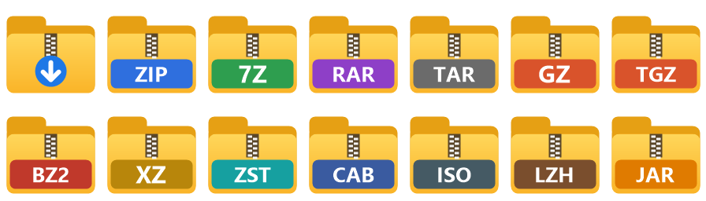

# QuickUnzip

Mac처럼 **압축 파일을 더블클릭하면 바로 풀리는** Windows용 작은 도구입니다.



- 압축 파일 옆에 바로 풀고, 풀린 폴더를 탐색기로 엽니다.
- 안에 폴더가 하나뿐이면 그 폴더를 그대로 꺼내고, 여러 개면 압축 파일 이름으로 폴더를 만듭니다.
- 이름이 겹치면 `이름 2`, `이름 3` …으로 만듭니다 (덮어쓰지 않음).
- `__MACOSX`, `.DS_Store` 같은 Mac 찌꺼기는 지웁니다.
- 한국어 Windows에서 만든 zip(CP949)의 한글 파일 이름도 깨지지 않습니다.
- 형식별 아이콘(ZIP, 7Z, RAR, TAR …)을 제공합니다.

## 지원 형식

`zip` `7z` `rar` `tar` `gz` `tgz` `bz2` `tbz` `tbz2` `xz` `txz` `zst` `tzst` `cab` `iso` `lzh` `lha` `jar`

zip은 .NET으로, 나머지는 Windows 10/11에 내장된 `tar.exe`(libarchive)로 풉니다. 별도 프로그램 설치가 필요 없습니다.
(ALZ, EGG 등 일부 형식은 지원하지 않습니다.)

## 설치

시작 메뉴에서 연 **일반 PowerShell**에서 실행하세요.

```powershell
cd $env:USERPROFILE; git clone https://github.com/sgc0907/QuickUnzip
powershell -ExecutionPolicy Bypass -File "$env:USERPROFILE\QuickUnzip\install.ps1"
```

> ⚠️ 스토어/패키지 앱(예: Claude 데스크톱 앱) 안의 터미널에서 실행하면 AppData·레지스트리 쓰기가 그 앱 전용 공간으로 리디렉션되어,
> 탐색기에서 더블클릭해도 "이 파일을 열 앱 선택" 창만 뜨고 풀리지 않습니다.

설치 위치: `%LOCALAPPDATA%\QuickUnzip\QuickUnzip.exe`
설정 → 기본 앱 목록에 등록하는 부분만 관리자 권한을 요청합니다 (Windows는 HKLM에 등록된 앱만 이 목록에 보여줍니다).

설치 중에 기본 앱으로 지정할지 묻습니다. **예**를 누르면 QuickUnzip 기본 앱 설정 화면이 열리고, 형식별로 눌러 QuickUnzip을 선택하면 됩니다.
(Windows는 프로그램이 기본 앱을 직접 바꾸지 못하게 막아 두어서 이 선택은 직접 해야 합니다.)

나중에 바꾸려면:

- **앱별로:** 설정 → 앱 → 기본 앱 → `QuickUnzip` → 형식별로 선택
- **형식별로:** 압축 파일 우클릭 → 연결 프로그램 → 다른 앱 선택 → `QuickUnzip` → **항상**

우클릭 메뉴의 **"여기에 바로 풀기"**도 함께 추가됩니다.

### 파일 이름 인코딩 (zip)

더블클릭은 **자동 감지**로 풉니다 (UTF-8로 올바르면 UTF-8, 아니면 한국어 CP949).
이름이 깨지면 zip 우클릭 → (Windows 11은 "추가 옵션 표시") → **QuickUnzip으로 풀기 ▸** 에서 직접 고를 수 있습니다:
자동 감지 / UTF-8 (Mac/Linux) / 한국어 (CP949) / 일본어 (Shift-JIS) / 중국어 간체 (GBK)

명령줄: `QuickUnzip.exe --enc=cp949 파일.zip`

## 제거

```powershell
powershell -ExecutionPolicy Bypass -File .\uninstall.ps1
```

## 구성

| 파일 | 설명 |
|---|---|
| `QuickUnzip.ps1` | 압축 해제 본체 |
| `QuickUnzip.cs` | 창 없이 본체를 실행하는 런처 (설치 시 자동 빌드) |
| `make-icon.ps1` | `icons\*.ico` 생성 |
| `install.ps1` / `uninstall.ps1` | 설치 / 제거 |
